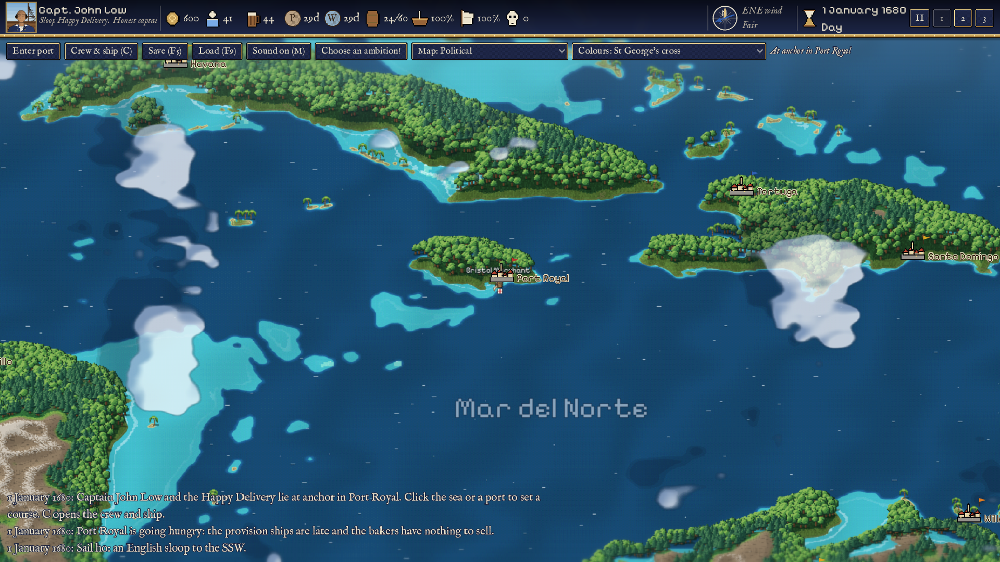
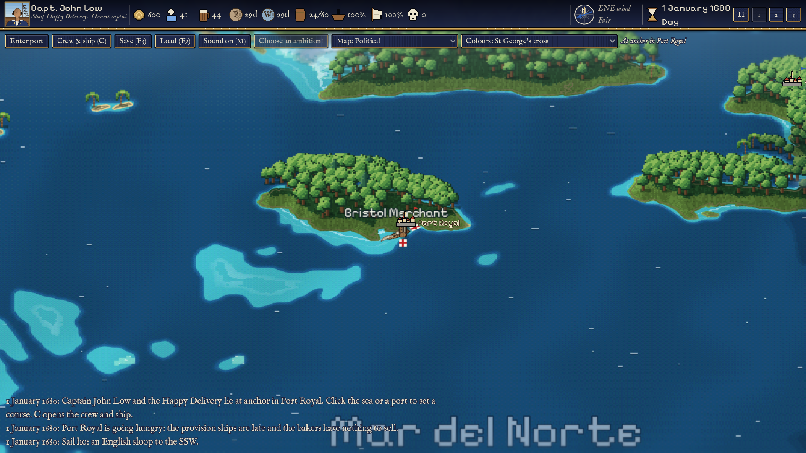
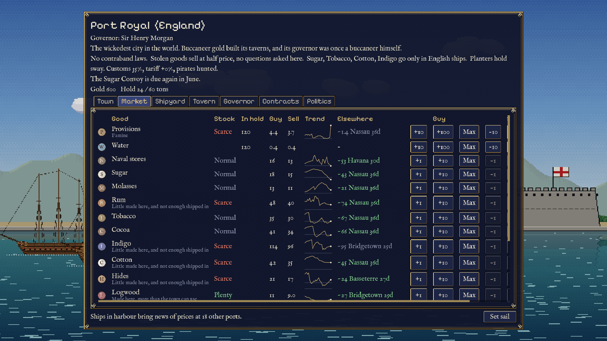
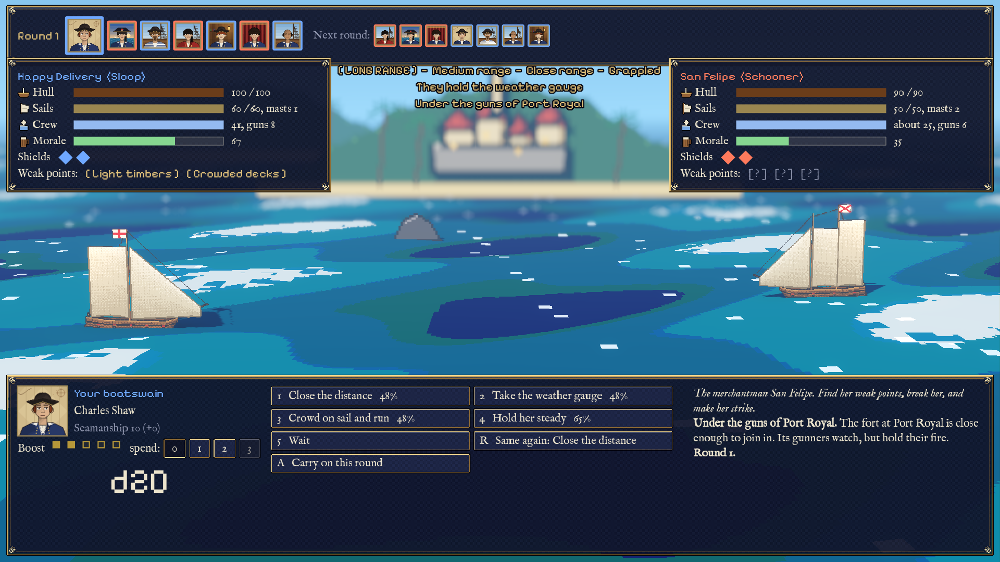
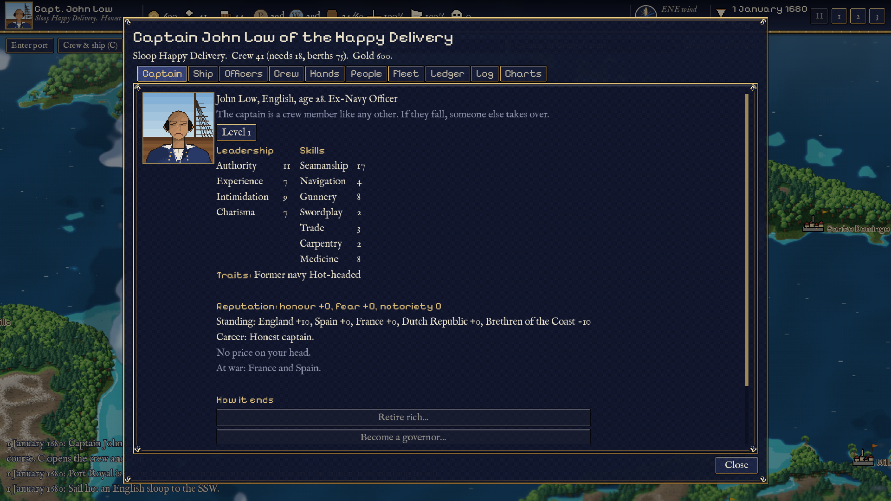
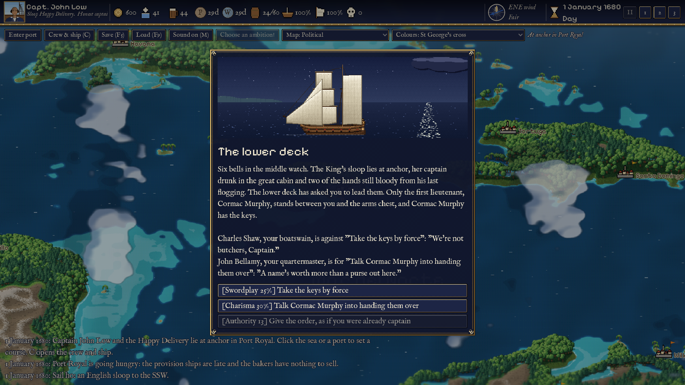
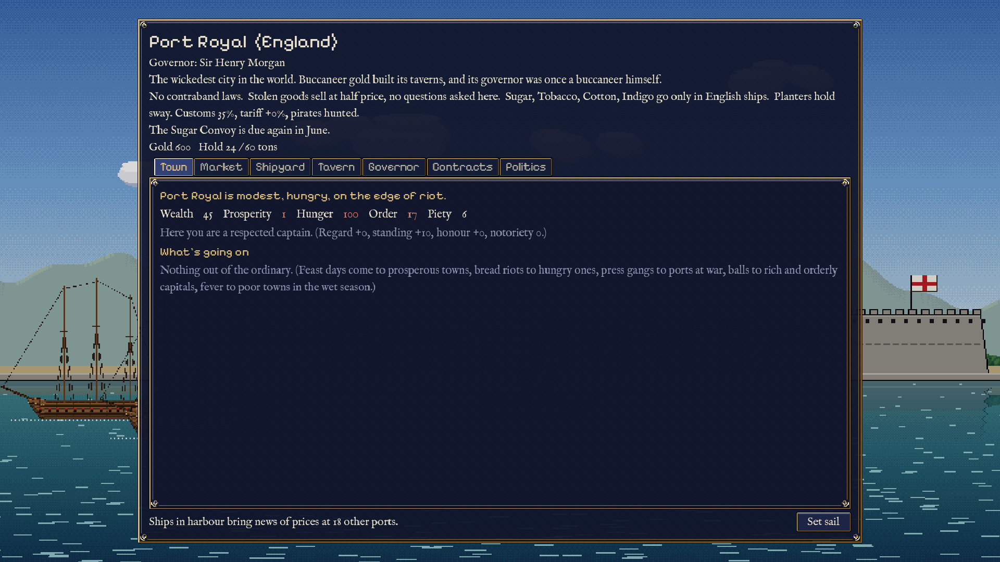
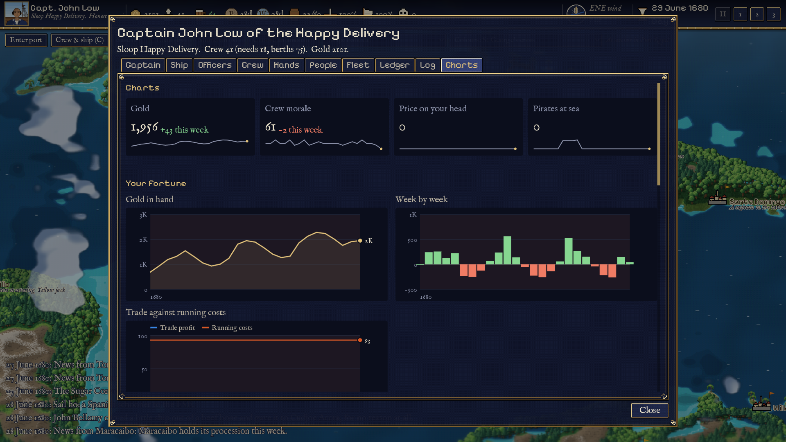
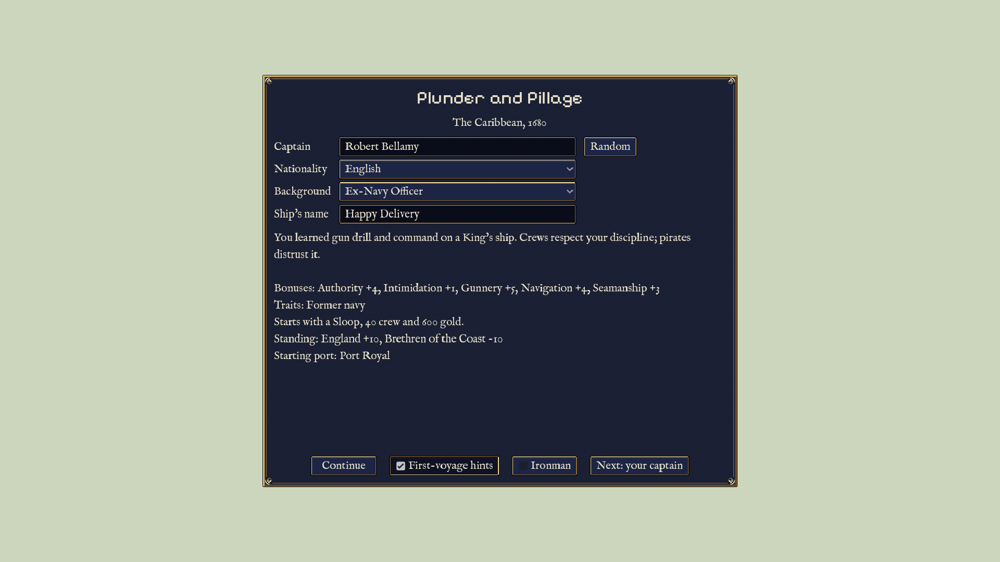

<h1 align="center">Plunder and Pillage</h1>

<p align="center"><b>A single-player pirate life in the Caribbean, 1680 to 1730.</b><br>
Trade, raid, take towns, and keep a crew of real people from cutting your throat.</p>

**Take the ship and see where it leads.** You start on the night you took a ship, and the people from that night come back later in your story. From there you decide what kind of captain you are. Carry sugar under a letter of marque, smuggle into Spanish ports, hunt the treasure fleet, take a town and rule it, or retire rich before the gallows catch up with you.

Like a Paradox grand strategy game, the world runs whether or not you're watching. Prices move with real merchant traffic, nations go to war and towns change hands, pirate companies rise and fall with the peace, and every number has a tooltip that says why. Time is pausable. The look is HD-2D, in the style of Octopath Traveler: pixel art lit in 3D for battles, and a tilted pixel-art chart of the Caribbean for the world.



*Built in Godot 4.7. In development (version 0.1.0): everything below is playable, and the balance and art are still moving.*

## What you do

### Sail a living Caribbean

The map is the real Caribbean, drawn from Natural Earth coastlines. You can't see past the horizon, so merchants, navy patrols, pirate hunters and other pirates turn up as sails. Most of them are ships of the economy itself: taking one is a real loss to that trade route. Hurricanes come in season, fog hides you, and reefs and shoals wreck ships that draw too much water.



### Trade on what you know

Every port produces and consumes goods, every day. You only know live prices where you are. Everything else is old news, carried in by other ships and as stale as their voyage. Spain bans foreign goods, so you smuggle. Fences in Tortuga and Nassau take stolen cargo. The treasure fleets flood the Spanish Main with goods, and the sugar convoys empty the islands.



### Fight turn by turn

Battles are turn-based, like Octopath Traveler: every officer on both ships acts once a round, rolling a d20 that you can see. Find the enemy's weak points to strip her shields and Break her, bank boost and spend it on one big broadside, then close to board. Night, weather, the weather gauge and a nearby fort all change the odds.



### Lead people, not stats

Your captain, crew, officials and rivals are all characters, with traits, wants, friendships and grudges. Officers speak up for or against your choices, and overruling them costs you. Put someone ashore and their friends resent it. Someone you dismiss may come back as a rival who knows your weak points. Starve or cheat your crew and they mutiny, and a pirate crew votes on its next captain.



### Stories, not random events

There are 306 events, many of them chained into stories with a start, a peak and an ending. Choices are tagged with the skill or trait they test, like `[Swordplay 40%]`, and acting against your nature slowly changes who your captain is.



### Towns that remember

Each port has wealth, hunger, order and piety, a governor and interest groups who set its laws, and a memory of what you did there. Bring food to a starving town and it remembers. Sack it and it remembers that too. Lay siege to a town, take it, and run it yourself: your laws, your taxes, and a rising if you get it wrong.



### Read the numbers

Like a Paradox game, the ship's log keeps a record of every week: your gold, what you earned and spent, the crew's mood, the price on your head, your standing with each nation and how much traffic is at sea. Wars and history events are marked on it. Hover over a week to see its numbers and what you did that week.



### And more

- **Careers:** letters of marque, pardons, false colours, a bounty from each nation and the hunters it sends.
- **Politics:** blackmail, favours, rival officials, and Nassau's council of captains.
- **Alliances and feuds** with named captains who sail the map and grow with their fame.
- **Bases:** hidden coves you can build up with storehouses, shipyards and forts.
- **A squadron of up to four consorts,** each with a captain who may desert you.
- **Wars between the nations,** with invasion squadrons you can catch at sea.
- **Ambitions and titles, endings** (retire rich, a governorship, a pirate republic, or the noose), and an **ironman** mode.



## Play

There's no download yet: a Windows build for itch.io is on the way. To play from source:

1. Install [Godot 4.7](https://godotengine.org/download) (the standard build, not .NET).
2. Clone this repo, then run `godot --path .` in it. Or open `project.godot` in the editor and press F5.

On Windows, if you put the Godot exe in `bin/`, `play.bat` starts the game with a double-click.

## Controls

| Key / mouse | Does |
|---|---|
| left-click the sea or a port | set a course (the route goes around land) |
| click a ship | give chase |
| wheel, right/middle-drag | zoom, pan |
| `F` | follow the ship |
| `Space`, `1` `2` `3` | pause, speed 1x / 2x / 4x |
| `C`, `L` | crew and ship screen; the same on its Charts tab |
| `F5`, `F9` | quick-save, quick-load |
| `M` | mute (remembered next time) |
| `Esc` | pause menu |
| in battle: `1`-`9`, `Q`/`E`, `R`, `A` | pick an action, spend boost, repeat the last order, carry on for the rest of the round |

Hover over anything with a number on it to see where the number comes from.

## For developers

Everything below is about how the game is put together.

Design rule: **deep, not wide.** Every feature has to create a decision for the player, and new features reuse existing systems. Design docs: `docs/brief.md` (the main brief), `docs/brief_additions.md` (political intrigue, alliances and rivalries), `docs/art_direction.md`, `docs/events.md` (how to write events) and `docs/representation.md`.

Screenshots: `bin/Godot_v4.7.2-stable_win64_console.exe --path . -s tools/screenshots.gd` starts a new game in a window and rewrites `docs/screenshots/`.

### Tests

```
bin/Godot_v4.7.2-stable_win64_console.exe --headless --path . -s addons/gut/gut_cmdln.gd
```
Or in the editor: GUT panel (bottom dock) > Run All. Tests live in `tests/`, config in `.gutconfig.json`.

### Layout

| Folder | What |
|---|---|
| `data/` | All game content as JSON. Every `*.json` here is loaded automatically by `scripts/data.gd`. |
| `data/map/` | Generated by `tools/build_map.py`. Don't edit by hand. |
| `scripts/` | Game logic. Autoloads (global singletons): `Data`, `Clock`, `Weather`, `Ports`, `People`, `Style`, `Factions`, `Politics`, `Bonds`, `Bases`, `Contracts`, `Events`. |
| `scenes/` | Godot scenes (`.tscn`): `world_map.tscn`, `combat.tscn`. `scripts/combat/` holds the dice (`dice.gd`), the battle rules (`dice_combat.gd`), the battle screen (`combat_view.gd`) and the aftermath (`encounters.gd`). |
| `ui/` | New-game screen, HUD, port screen, crew screen. `ui_kit.gd` has the shared row/tooltip helpers. |
| `assets/` | Art (see Art below) and `CREDITS.md`, the licence manifest. |
| `tests/` | GUT unit tests. `test_scripts_compile.gd` loads every script and scene, so broken UI code fails the suite too. |
| `tools/` | Offline Python tools (ignored by Godot through `.gdignore`). |
| `addons/gut/` | GUT test framework (MIT). |

### Data

JSON, not Godot `.tres` Resources: it's easy to write in any editor, compare in git, and generate in batches (for example, hundreds of events from a script).
Each table is a dictionary keyed by id. `scripts/data.gd` has a small `SCHEMA` listing the required fields and cross-references. A bad entry fails at startup with the file, the entry and the field. Add a table to `SCHEMA` when it gains required fields.

- `rules.json`: global tuning (time scale, start state, upkeep, wind, storms, market, smuggling, shipyard, tavern, market events).
- `ports.json`, `goods.json`, `factions.json`, `ships.json`: content. A port's `laws` are only its starting laws; the live copy is saved with the game so it can change.
  Each port has a `population`, `tags` (capital, plantation, free_port, pirate_haven, fair_town, garrison) and what it `make`s each day.
- `economy.json`: the trade economy. Every port, every day: stock += production x season + imports - consumption - exports - spoilage, and the price follows stock against normal stock. Consumption per 1,000 people, tag multipliers, seasons, duties, spreads, and the outside trade that stands in for merchant traffic. `scripts/economy/economy_model.gd` is the model (no nodes, runs headless); the `Economy` autoload runs it on the clock.
- Headless economy runs: `bin/Godot_v4.7.2-stable_win64_console.exe --headless --path . -s tools/economy_sim.gd -- --years 15 --seed 1` writes `tools/out/economy.csv` (port, good, week: stock, prices, flows) and prints health checks (prices pinned at a limit, widest swings, cheapest and dearest port per good).
- Balance report: `bin/Godot_v4.7.2-stable_win64_console.exe --headless --path . -s tools/balance_sim.gd -- --runs 20 --years 50`
  prints how often wars start and towns change hands, how fast the price on your head grows (`--attacks 3 --sack 12`), what each
  held town earns at each tax level against its upkeep and its odds against expeditions, and the odds each town falls to an invasion.
- Market events (shortages, gluts, poor harvests) are in `rules.json` under `market_events`; add more there.
- `ships.json` (8 types, each with its own polar curve for points of sail), `upgrades.json` (effects use `set`, `add` and `mult` on any ship stat; `group` makes upgrades replace each other).
- `history.json`: dated wars, peace treaties and pardons (1680 onwards). `scripts/factions.gd` applies them; `scripts/career.gd` judges every attack
  (lawful prize under a letter of marque, or piracy), and handles ranks, the Crown's share, pardons, closed ports and false colours.
- `scripts/economy/traffic.gd`: merchant voyages. Ports send out merchants who pick the cargo and destination with the best expected profit, using price news carried by earlier ships; goods land only when a ship arrives, ships tramp on from port to port, and routes remember losses (pirates, storms, you), so a raided route sees fewer ships and dearer goods at its end. Tuned in `economy.json` `traffic`.
- `scripts/economy/fleets.gd`: the Spanish treasure fleets (the flota to Veracruz in autumn, the galeones to Cartagena and Portobelo in spring; irregular after 1700) flood the Spanish Main with European goods at their fairs and carry off the silver; a treasure galleon then sails for Havana, for you to try. The English and French sugar convoys buy up sugar and rum in summer. Each Spanish port shows when its fleet is due. Data in `economy.json` `fleets`.
- What you know: live prices only where you are. Elsewhere you know what you last saw or heard, and how old it is. When you dock, ships in harbour bring news of the ports they came from (each port's news is only as fresh as its last ship in from there); a captured merchant's papers hold her home port's prices as she sailed; tavern rumours repeat old news and are sometimes false. News of events (fleets, shortages) reaches you at sailing speed from where it happened. The market's "Elsewhere" column is your best trader's estimate of today's price from that old news ("~"), with the reasoning in its tooltip; trade skill and allies make it closer (`economy.json` `information`).
- Laws: Spain admits only Spanish ships, so Dutch and English smugglers run forbidden goods in, and some are taken by the guarda costas (Spanish warships attack any foreign ship carrying those goods). English and French ports' enumerated goods (`laws.enumerated`) go only in their own nation's ships: loading them under other colours is smuggling. Fences (Tortuga, Nassau) pay nearly full price for stolen goods and more as they come to trust you, but have only so much coin; silver and gold sell cheap outside Spanish ports and fences (`rules.json` `fence`).
- Market events: random shocks (`economy.json` `shocks`: hurricanes, fevers, failed and bumper harvests, fires, bankruptcies, reinforced garrisons, coin shortages, waves of piracy; about one a month somewhere, news travelling at sailing speed); the historical timeline (`data/history.json`: wars and peaces, the Port Royal earthquake, the sack of Cartagena, Utrecht and the asiento, the 1715 fleet wreck, Woodes Rogers at Nassau unless you stop him, the South Sea Bubble, the 1722 hurricane, Hosier's blockade); and structured `effects` on event choices (`scripts/economy/effects.gd`, listed in `docs/events.md`).
- `scripts/economy/brethren.gd`: the pirates as a population (`economy.json` `piracy`). Companies of men, each with a captain and a ship, work the real cruising grounds (the Windward Passage, the Florida Straits, the Leeward Islands, the Spanish Main, the Bay of Honduras), picking the one with the most shipping and the fewest men-of-war, and many go north in the hurricane months. They recruit from out-of-work seamen: a long war takes seamen into the navies and privateers and the peace pays them off, so the boom after Utrecht comes on its own. Prizes bring volunteers and big companies split; disease, the navy, the gallows, the King's pardon and, with no haven left, the long voyage east thin them out. A nation that loses merchants sends more men-of-war, a year or so late. Every company in the islands is a real ship on the map with the company's captain, name and men; taking her, or the navy taking her, ends the company. `tools/economy_sim.gd` prints the numbers each year to check against history (about 2,000 pirates at the 1717-1722 peak, after Rediker).
- `scripts/shipping.gd`: NPC ships. Merchants are the economy's voyages, drawn when they pass near you; taking one is a real loss to that route. The "Trade routes" map mode shows busy routes (thicker) and risky ones (red, "raiders").
- `contracts.json`: contract templates (employer, requirements, objective, tiers unlocked by trust, rewards, lie and trap chances).
  `scripts/contracts.gd` runs them: three objectives (raid, intercept a named ship that really sails the map, deliver) cover every template.
  Employers are characters; their trust in you is their relation to your captain. Tuning in `rules.json` `contracts`.
- `politics.json`: political intrigue (`scripts/politics.gd`). Every port is run by people (governor, harbour master, garrison commander,
  merchant prince, planter, priest, broker) on the shared character model, with goals, rivalries and turnover. Interest groups (planters,
  merchants, military, church, townsfolk) hold influence that sets the live laws: customs vigilance, tariff, pirate policy, pardon price.
  Secrets (blackmail, sell to a rival, expose to the Crown; some are forged, some go stale), favours owed both ways, and Nassau's council
  of captains. Political contracts shift influence; NPC enemies scheme against you through events in `events/intrigue.json`.
- `bonds.json`: alliances and rivalries (`scripts/bonds.gd`) with named NPC captains (a roster who sail the map), council captains,
  officials and nations. Alliance levels (understanding, pact, alliance, brotherhood or patronage) and rivalry levels (competition,
  feud, blood feud), each with real benefits and costs; acceptance is shown as a breakdown before you propose. NPCs have their own
  friendships and feuds. Bond events in `events/bonds.json`.
- `coves.json`, `buildings.json`: hidden coves and base buildings (`scripts/bases.gd`). Sail close and your navigator may spot a cove
  (or hear of one in a tavern); claim it with gold and a garrison. Buildings cost gold, days and upkeep, and each does something:
  storage safe from capture, production, cheap repairs and careening, recruits, a smugglers' market, a stockade for ransoms, guns.
  Visibility grows with activity; visible bases get raided. Be there and you fight with the shore guns beside you; be away and the
  defence (garrison, walls, shelter, manager, warning, allies) is rolled against the raiders. Base events in `events/bases.json`.
- Taking towns (`scripts/sieges.gd`, the dialog in `ui/siege_flow.gd`, tuning in `rules.json` `sieges`): lay siege from the governor
  tab or a closed harbour. Each turn: scout, fight the guard ship, bombard the fort, blockade (the town starves and may riot), wait
  for allies, bribe the gate, arm a rioting town, raid by night, or storm a side of your choice; a relief squadron is on its way.
  Then sack it (gold, ruin, a governor's feud), ransom it, or hold it: a held town is a base keyed by its port id, paying taxes,
  attacked by expeditions from its old masters. Capitals need a squadron. Leading Nassau's council hands you Nassau the same way.
  A lifted siege is remembered (`s.sieges`): come back and the damage is still there, less repairs. Consorts' crews land and die too.
  A held town is yours: no duty, your laws, no officials but your manager; you set its taxes (light, fair, heavy), and its loyalty
  follows taxes, order and hunger. Expeditions grow with each one beaten and sail from a real port: catch one at sea and it's over.
  Any base whose loyalty collapses may rise against you (`bases` `rebel_below`). Plantations and stills need hands from the garrison.
- Wars of the moment (`scripts/factions.gd`, `rules.json` `diplomacy`): tension between nations drifts and rises with incidents
  (privateer raids, false colours, sacks); at war, each side sends invasion squadrons against the other's smaller towns: real ships
  that sail from their nearest port ("ATTACK COMING" on the chart), which you can catch at sea to save the town (and win its
  nation's thanks). If they get there, they roll against the fort, walls and garrison (`Ports.change_owner`); the peace may hand towns back.
- The price on your head (`Career.add_bounty`, `rules.json` `career.bounty`): piracy and sacks raise it per nation; hunters come in
  bigger ships as it grows; that nation's pardon clears it. Named captains grow (`bonds.json` `growth`): fame from prizes and from
  beating you buys bigger ships; the dead are replaced. Smugglers, coasters and guarda costas sail too (`encounters.json`).
- Contracts also escort, blockade, take a town (`siege`) and kidnap; employers remember how your last job ended (`last_job`), and
  templates with `after` follow from it (a second chance, finishing the town you blockaded).
- Endings (`scripts/endings.gd`, `rules.json` `endings`): retire rich, a governorship, a pirate republic at Nassau (chosen from the
  crew screen); hanged, lost at sea, or no one left (they choose you). The crew screen's Log tab reads back the line of captains.
  New games can be ironman (one save, written in every port, gone at the end) and have first-voyage hints (`data/tutorial.json`).
- `events/*.json`: random and historical events (306 so far, in batches by category). `scripts/events.gd` is the engine;
  `docs/events.md` explains the format for writing more. Every event is checked at startup and by the tests. Tuning in `rules.json` `events`.
- `encounters.json`: who you meet at sea (ship types, crew, morale, cargo, how hostile, prisoner willingness). Battle actions per officer post are in `combat_actions.json`; dice, damage, morale and AI crews are tuned in `rules.json` `dice_combat`. Prisoner fates and prize rules: `prisoners`, `prizes`, `fence`.
- `traits.json`, `nations.json` (names and recruiting), `backgrounds.json` (captain starts). `pools` says who can roll a trait: `crew`, `official` or both.
- `events/night.json`: the night you took the ship, the first thing a new game plays (one per background, `backgrounds.json` `night`): it sets your nature and brings in someone whose story (`events/origins.json`) finds you later. `focus.json`: the captain's focus, a CK3-style lifestyle that teaches its perks (in `perks.json`) over time. `rules.json` `nature`: how acting against a trait wears it away and leaning one way gives you one (scripts/nature.gd).

### Characters

Everyone is a character on one model, kept in the `People` autoload: the captain, the crew, and later officials, rivals and council captains.
A character has four leadership stats (authority, experience, intimidation, charisma), seven skills, 1 to 3 traits (some hidden), relations and a history, all 0 to 20.
Traits change numbers even while hidden; tooltips show those modifiers as "something you don't know". Skills level up with use.
The captain is just the character whose id is in `ship.state.captain`; succession changes that id.

`scripts/crew.gd` treats the crew as a body of people: morale (every part explained in its tooltip, plus timed modifiers from victories,
defeats, mourning and events), articles (wages, or no prey, no pay, and the crew's share of every plunder; pirate crews vote on changes),
rum, disease (scurvy, flux, yellow fever; the sick can't work), friendships and feuds, and unrest: a ringleader recruits the discontented,
one stage a week (grumbling, round robin, weapons missing, black spot, mutiny), with events in `data/events/mutiny.json` for each stage.
If the captain dies or is deposed, a pirate crew votes and anyone else follows the chain of command; a hard case can seize the ship by force.
Name a successor in the crew screen to back them. Tuning in `rules.json` `crew`.

Civics (`scripts/civics.gd`, `data/civics.json`) are standing choices with a price, one per slot, each changeable once a month.
The ship's articles (crew screen): discipline (the lash, an easy ship), quarter (none given, fair dealing) and the maimed (a fund).
A held town's laws (base screen): rule (martial law, a council of townsmen) and harbour (a free port, closed to the Brethren).
Pirate crews vote on new articles; anyone else imposes them, and a harsher one is resented. Effects are read where each number is made:
`Civics.bonus(holder, key)`. Add an option by adding an entry; add a new effect key by reading it where it applies.

### Saves

`user://saves/quicksave.json` (on Windows: `%APPDATA%/Godot/app_userdata/Plunder and Pillage/saves/`). Readable JSON. Each system has `save_state()` and `load_state()`; `scripts/save_game.gd` collects them.

### Art

Everything is swappable: code only knows art through paths in `data/`.

| What | Where | Referenced from |
|---|---|---|
| Colours, fonts, pixel window frames | `data/palette.json` | `scripts/style.gd` builds the UI theme from it at startup; code asks `Style.c("ink")` |
| Ship layers (hull, damaged hull, sails furled/half/full/torn) | `assets/ships/<type>/` | `ships.json` `art` |
| Flags (nations, black, red, white) | `assets/flags/` | `flags.json`, `factions.json` `flag`, ship `state.flag` |
| Portrait parts, by layer | `assets/portraits/<layer>/` | `data/portraits.json` (tags pick clothing by role; seeds keep faces stable; wounds and age change them) |
| Goods icons | `assets/icons/goods/` | `goods.json` `icon` |
| Sea and paper shaders | `assets/map/*.gdshader` | `scripts/sea_layer.gd` |
| Chart lettering | `data/map_labels.json` | `scripts/map_layer.gd` |
| Particle puff | `assets/fx/puff.png` | combat smoke, splashes, splinters |

The current art is generated placeholder art (`tools/make_placeholder_art.py`, CC0). Replace any PNG with real art at the same path,
or point the data at a new file. List every third-party asset in `assets/CREDITS.md`. No AI-generated images as game assets.

### Map

The coastline comes from Natural Earth 1:10m (public domain). Shallows are areas shallower than 200 m (`ne_10m_bathymetry_K_200`).
To rebuild it (for example, to change the bounds or the detail level):
```
python -m venv tools/.venv && tools/.venv/Scripts/pip install shapely pillow
# download ne_10m_land, ne_10m_minor_islands, ne_10m_bathymetry_K_200 .geojson into tools/cache/
#   from https://github.com/nvkelso/natural-earth-vector/tree/master/geojson
tools/.venv/Scripts/python tools/build_map.py
```
It writes `coastline.json` (polygons for drawing) and `terrain.png` (a mask at 1 pixel per 4 map pixels, used for land and shallow checks and route finding).
Scale: 100 map px = 1 degree of latitude = 60 nautical miles.
