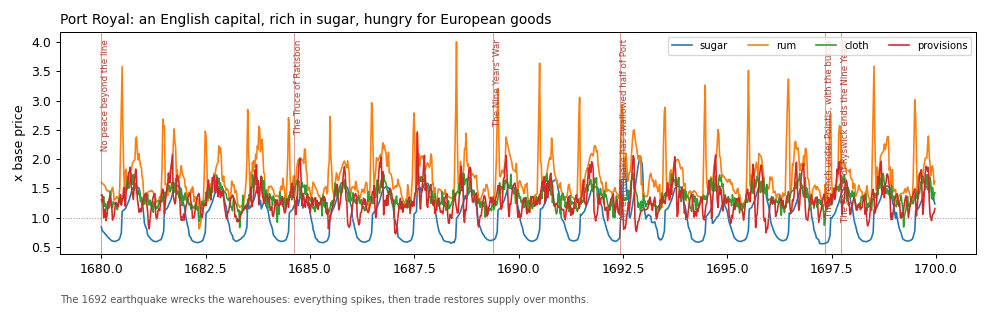
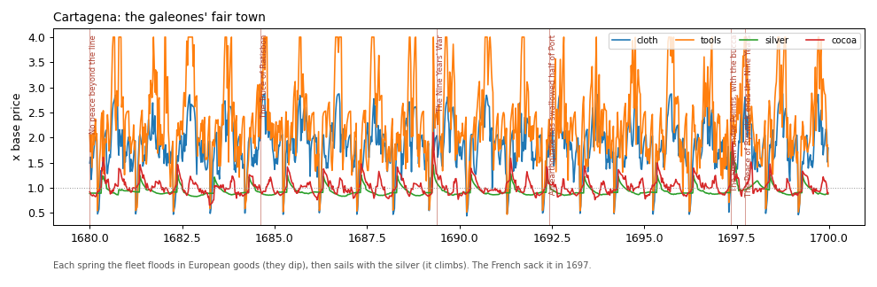
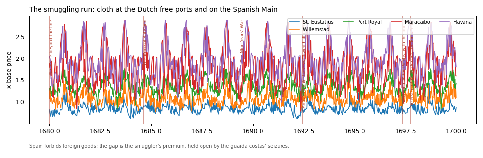
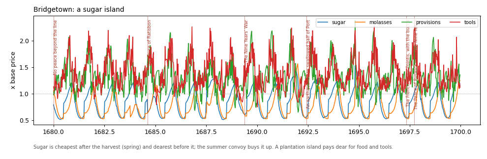

# Economy report (market milestone 6)

A 20-year headless run from 1680, seed 1, with the history timeline applied: about 2,370 merchant voyages a year,
9.9% lost to storms, pirates and the guarda costas, and no price pinned at its floor or ceiling.

To reproduce:

    bin/Godot_v4.7.2-stable_win64_console.exe --headless --path . -s tools/economy_sim.gd -- --years 20 --seed 1
    python tools/economy_report.py
    bin/Godot_v4.7.2-stable_win64_console.exe --headless --path . -s tools/economy_check.gd -- --years 15 --seed 1

Prices are shown as a multiple of each good's base price. The red lines mark history events.

## Port Royal

Sugar follows the harvest every year. Rum is the jumpy one: Port Royal drinks it fast, so a late sloop shows at once.
The 1692 earthquake lifts everything together, and trade brings prices back down over a few months.

## Cartagena

The galeones' fair is the heartbeat here. European cloth and tools drop when the fleet lands and climb all year as
the fleet's cargo runs out. Silver and cocoa stay near base, because the town makes them.

## The smuggling gap

Cloth costs about 0.8× at St. Eustatius and 1.5-2.8× at Havana and Maracaibo. Spanish law forbids foreign goods,
and the guarda costas' seizures keep the gap open. Port Royal sits between the two, as a smugglers' base should.

## Bridgetown

Sugar and molasses are cheapest after the spring harvest and dearest before it. A sugar island pays dear for food
and tools.

## The checks

`tools/economy_check.gd` passes all of these on seeds 1-4:

| Check | Result (seed 1) |
|---|---|
| No price pinned at a limit over a fifth of the time | none |
| Food never runs out for good | longest run without food: 0 weeks |
| Stock never piles up forever | nothing above 8× normal for half a year |
| Price gaps open and close | each run opens 9-59 times in 15 years |
| Sugar cheaper after the harvest | 15 of 15 years |
| The fair floods the Spanish Main | Cartagena cloth fell in 15 of 15 fairs |
| A shock fades | a fire burning 60% of Port Royal's stock (+25% prices) fades in 8 weeks |
| Raiding a route raises prices at its end | a season of raiding Havana to Tortuga: +18% at Tortuga |

The last two are paired runs: the same seed with and without the fire or the raid, so that is the only difference.

## What was tuned

- **Maracaibo makes naval stores** (1.5). Its tar seeps were real, and without them the Main had no local supply.
- **Treasure re-export cut to 0.3.** Silver was leaving the Main faster than the fleet carried it, which pinned
  prices.
- **The galeones bring more** cloth (90) and wine (80), and the fair uses 1.25× of each. Before this, the fair
  barely moved prices.
- **Approach risk.** A route's risk is now the larger of its own risk and the danger off its destination: 60% of
  each non-storm loss is added to the approach. Before this, raiding one route just sent merchants another way into
  the same port, so prices didn't move. Now a raider off a port scares off everyone heading there, and the market
  shows "Raiders off the coast".
- The simulator applies the history timeline (`_history()`), so the 1692 earthquake and the 1697 sack of
  Cartagena now show up in headless runs.
